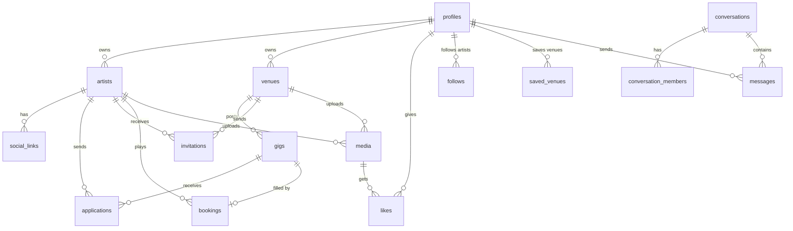

# Stagecall database

PostgreSQL schema for Stagecall, written for [Supabase](https://supabase.com) (free tier). Supabase was chosen because the app is a static page on GitHub Pages with no server of its own. With Supabase, the page can talk to a real database directly, and the same service also provides login and file storage for videos, audio and photos.

| File | What it does |
|---|---|
| `schema.sql` | Tables, types, the distance functions, and the `gig_cards` view |
| `policies.sql` | Row-level security (who can read and write what), the sign-up trigger, and the application rules |
| `seed.sql` | Sample data matching the prototype: 10 venues in real Arkansas towns (home is Fayetteville), 5 artists, 10 gigs (4 already booked as live shows), 7 reels |
| `test.mjs` | 39 automated checks run against real Postgres |
| `migrations/` | Upgrades for the live database, applied in number order. A fresh setup doesn't need them: `schema.sql` and `policies.sql` already include every change. |

## Tables



| Table | Prototype feature |
|---|---|
| `profiles` | One per signed-in person. `role` is artist, venue or fan. |
| `artists`, `venues` | Artist profile page, venue profile page |
| `social_links` | "Link Instagram / YouTube / Spotify / SoundCloud" |
| `gigs` | "Post a gig" sheet, "Your open gigs", "Gigs in reach" |
| `applications` | "Apply" / "Tap to withdraw" |
| `invitations` | "Invite to a gig" on Reels |
| `bookings` | Confirmed artist, pay and deposit (not in the UI yet) |
| `media` | Portfolio videos/audio, venue photos, and the Reels feed (`in_reels = true`) |
| `likes`, `follows`, `saved_venues` | Heart, "Follow", "Save venue" |
| `conversations`, `messages` | Messaging (not in the UI yet) |

Some conventions:
- **Money is stored in cents** (`pay_cents = 18000` means $180), which avoids rounding errors.
- **Enum values match the strings `index.html` already uses** (`'DJ'`, `'Band'`, `'Region'`, `'Gas + room'`...), so the app doesn't need a translation layer.
- **Card details are never stored here.** A payment provider such as Stripe would hold them, and `bookings.payment_provider_ref` keeps only its reference ID.

## How "Gigs in reach" works

```sql
select * from gigs_in_reach('<artist id>', 'Region');        -- all types
select * from gigs_in_reach('<artist id>', 'Statewide', 'DJ'); -- DJ gigs only
```

A gig shows up only if it passes **both** of these checks:
1. It is within the distance the artist picked ("How far will you go?").
2. The artist is within the distance the venue picked ("Draw artists from").

The prototype only applies the first check. Town is 15 mi, Region is 75 mi, and Statewide has no limit, the same as `RANGE_MILES` in `index.html`. Results come back with `miles` and are sorted nearest first.

## Security

The browser uses Supabase's public "anon" key, so **row-level security is what protects the data**:
- Profiles, acts, venues, media and open gigs can be read by anyone.
- Only the owner can edit them.
- An application is visible only to the artist who sent it and to the venue that owns the gig.
- The artist can only apply or withdraw. The venue can only accept or decline.
- Messages are visible only to members of the conversation, and only the sender can post as themselves.
- Helper functions live in a `private` schema that the API doesn't expose, so they can't be called from the browser.

`test.mjs` tries to break each of these rules.

## Set it up on Supabase (one person does this once)

1. Create a free project at [supabase.com](https://supabase.com).
2. Open **SQL Editor**, paste and run `schema.sql`, then `policies.sql`, then `seed.sql` (optional).
3. Under **Project Settings → API**, copy the **Project URL** and the **anon public** key and share them with the team. The anon key is meant to be public. **Never** commit or share the `service_role` key.
4. Under **Storage**, create a bucket named `media` for uploads.
5. Add the instructor to the project if they need access.

To start over, run `drop schema public cascade; create schema public;`. Then grant the default Supabase privileges again, or simply create a new project.

## Connect the app (next step, not done yet)

```html
<script src="https://cdn.jsdelivr.net/npm/@supabase/supabase-js@2"></script>
<script>
  var sb = supabase.createClient('https://<project>.supabase.co', '<anon key>');
  sb.from('gig_cards').select('*').eq('status', 'open').then(function (r) { console.log(r.data); });
</script>
```

## Run the tests

You need Node.js. From the `db/` folder:

```
npm install
npm test
```

The tests load all three files into PGlite (real Postgres running in Node, no install or account needed), then check that:
- the sample data matches the prototype's gig counts for each range (4 / 5 / 6 for Mara; booked gigs drop out, as in the app),
- the venue's reach limit is respected,
- every security rule holds.

Supabase's `auth` schema is replaced with a small stand-in, so after the first real Supabase setup, also run a quick manual check there.
